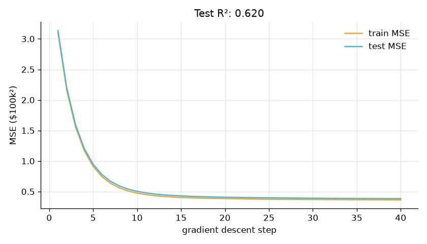

# House Price Prediction

**Supervised learning · regression.** Predicts the median house value of a California district from its location, age, rooms and local income, with linear regression. My first complete ML workflow: cleaning, feature engineering, training and evaluation.

Part of my ML portfolio, [LabOS](https://github.com/abdimajeet/labos-portfolio), where this project's training curve and results are shown in the Model Lab app.



## Results

| Metric | Value |
|---|---|
| Test R² | 0.620 |
| Test RMSE | $60.3k |
| Mean-only baseline | $97.9k |

## What I found

- Median income is the strongest single signal (correlation 0.69 with price).
- 4.8% of districts were capped at $500k in the census, so I removed them instead of letting the model learn a fake ceiling.
- Location matters: the biggest coefficients are latitude and longitude. Before cleaning, districts west of longitude −121.5° had a median value of $224k vs $168k further east.
- My hand-written gradient descent reaches a test error of $62.0k after 40 steps, close to the exact least-squares solution ($60.3k).
- The model explains 62% of the variation in price and cuts the error from $98k (always guessing the average) to $60k. A straight line can't capture neighbourhood effects, which is the obvious next step.

## How it works

- **Problem:** Predict a California district's median house value from its location, age, size and local income.
- **Dataset:** California Housing, 1990 US census: 20,640 districts, 8 numeric columns (Pace & Barry, 1997).
- **Preprocessing:** Removed districts whose value was capped at $500k; added rooms per household, bedrooms per room and people per household; clipped extreme ratios to the 1st–99th percentile; standardised all features; 80/20 train/test split.
- **Exploration:** Checked how each feature correlates with price, how many values are capped, and how price varies with location.
- **Model:** Linear regression, solved two ways: exactly (least squares, scikit-learn) and with batch gradient descent written by hand, so the error can be watched falling step by step.
- **Evaluation:** R² and RMSE on the test set, compared with always predicting the average price.

| Setting | Value |
|---|---|
| model | Linear regression |
| dataset | California Housing, 19,648 districts |
| features | 7 (3 engineered) |
| split | 80 / 20 |
| optimizer | least squares + gradient descent |

## Run it

```bash
python -m venv .venv
.venv\Scripts\activate        # Windows; on macOS/Linux: source .venv/bin/activate
pip install -r requirements.txt
python house_price.py
```

The first run downloads the dataset into `data/`. The script prints its progress and writes `results/house-price.json` (scores, curve, findings) and `results/house-price.png` (the chart above).

## Files

- `house_price.py`: the whole project, top to bottom: load, explore, preprocess, train, evaluate.
- `common.py`: dataset download, rounding, and saving results and the chart.
- `results/`: output of the last run.

## License

Code: MIT. Datasets belong to their authors; see the dataset links in `common.py`.
